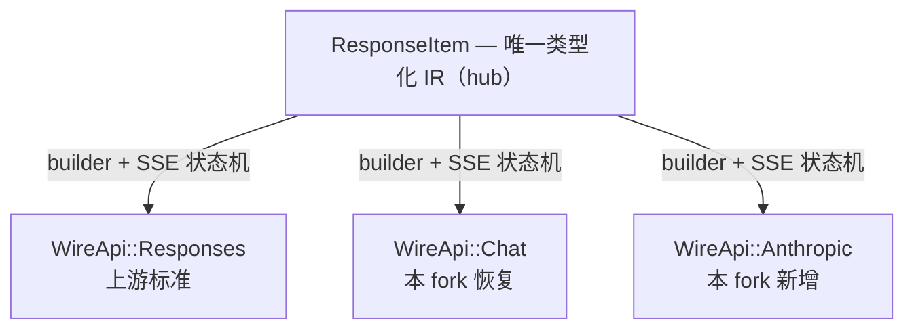

> English version: [README.md](README.md)

<p align="center"><strong>Codex CLI</strong> 是 OpenAI 的编程 Agent，本地运行在你的电脑上。
<p align="center">
  
</p>
</br>
如果你想在代码编辑器（VS Code、Cursor、Windsurf）里使用 Codex，<a href="https://developers.openai.com/codex/ide">在 IDE 中安装</a>。
</br>如果你想要桌面应用体验，运行 <code>codex app</code> 或访问 <a href="https://chatgpt.com/codex?app-landing-page=true">Codex App 页面</a>。
</br>如果你要找的是 OpenAI 的<em>云端 Agent</em>（<strong>Codex Web</strong>），前往 <a href="https://chatgpt.com/codex">chatgpt.com/codex</a>。</p>

---

## 关于本 fork（tri-wire-api）

这是 `openai/codex` 的一个 fork，在单一内部表示上恢复并原生实现**三条出站 wire 协议**：

- **Responses**（`/v1/responses`）— 上游仅存的 wire。
- **Chat Completions**（`/v1/chat/completions`）— 上游 2026 年 2 月删除（PR #10157）；本 fork 将其恢复为一等协议。
- **Anthropic Messages**（`/v1/messages`）— Claude 原生，含 extended-thinking 链（`thinking_delta` / `signature_delta` SSE 帧、`budget_tokens` 钳制、`cache_control` 临时断点、`thinking` 块的逐字签名保真重放）。

**心智模型（fork 为什么长这样）：**

1. **一个 IR，三条辐条。** 所有 wire 共享 `ResponseItem` 作为唯一内部表示（hub-and-spoke，不做两两翻译）。复杂度保持 O(N) 而非 O(N²)。
2. **最小 fork 缝。** 与上游的分歧收敛在约 3 个注册点：`WireApi`、`ModelProviderInfo`、`core/src/client.rs` 的 per-wire 分发。上游仍只定义 `WireApi::Responses`，所以我们的 chat/messages 变体永远不会与上游漂移相撞。
3. **goose 蓝图的 Anthropic 实现。** `codex-api/src/sse/messages.rs` 的 Anthropic SSE 状态机仿照 goose（Block 的 Rust agent）的模式，不是手搓解析器。
4. **真实网关验证过。** 每条 wire 都在真网关上端到端联调过（H1 联调档案）：工具调用、并行工具调用分组、`max_tokens` 触顶信号、thinking 链往返。任何降级都是响亮失败，不是静默——例如被截断的 `tool_use` JSON 会以 `ApiError::Stream` 冒出，绝不伪造 `{}`。
5. **按 provider 调参。** 额外的 `anthropic_max_tokens`、`anthropic_thinking_budget`、`anthropic_prompt_caching` `Option<_>` 字段加上 `anthropic_adaptive_thinking` 开关，让每个 provider 自行选择，不动全局默认。

上游跟踪为 `upstream/main`。

### Fork 文档地图

什么内容去哪读（只放链接不复制——每层都是自己内容的唯一权威）：

1. **[CONTEXT.md](CONTEXT.md)** — fork 的词汇权威：tri-wire 术语、用法/禁用配对、出处。命名任何新东西之前先读它。
2. **[docs/adr/](docs/adr/)** — 决策记录，append-only（[索引](docs/adr/README.md)）：0001 fork 基线与同步、0002 合并裁决、0003 Gemini 裁决、0004 reasoning_content 透传、0005 reasoning_effort 翻译、0006 fork 分歧补丁队列。
3. **[AGENTS.md](AGENTS.md)** — 面向 agent 的规则；「Fork maintenance constitution (tri-wire-api)」一节是 fork 红线与执行者规则。嵌套链（就近文件优先）：[codex-rs/AGENTS.md](codex-rs/AGENTS.md) → [core/src/client/wire/AGENTS.md](codex-rs/core/src/client/wire/AGENTS.md) 是 per-wire 协议红线。
4. **CI**：`.github/workflows/fork-health.yml` 是每日 fork 缝看门狗（seam crate clippy + wiremock 套件 + 漂移探测）；`fork-cli-test-release.yml` 跑三平台检查 + 发行构建。重构建只在 CI 跑。
5. **版本控制**：用 [GitButler](https://gitbutler.com) 维护（虚拟分支，一票一道）；上游同步 merge `upstream/main`，绝不 rebase（ADR-0001）。

### 三条 wire 的用法（Responses / Chat / Anthropic Messages）

`wire_api` 是**一个 provider 一个协议**——没有自动协商，没有故障转移。要同时用多个协议，声明多个 provider（可以指向同一个 base URL），每次运行用 `-p` 选一个：

```toml
# ~/.codex/config.toml

# 默认：上游行为，一个 provider，一条 wire
model_provider = "openai"

# --- Responses wire（OpenAI 原生 /v1/responses）---
[model_providers.gw-resp]
name        = "gw-resp"
base_url    = "https://example.com/v1"   # 注意：路径停在 /v1；wire 自己追加 /responses、/chat/completions 或 /messages
wire_api    = "responses"
env_key     = "MY_API_KEY"

# --- Chat Completions wire（OpenAI 旧协议，本 fork 恢复）---
[model_providers.gw-chat]
name        = "gw-chat"
base_url    = "https://example.com/v1"
wire_api    = "chat"
env_key     = "MY_API_KEY"

# --- Anthropic Messages wire（/v1/messages）---
[model_providers.gw-msg]
name        = "gw-msg"
base_url    = "https://example.com/v1"
wire_api    = "anthropic"
env_key     = "MY_API_KEY"

# 可选的 anthropic 专属旋钮（按 provider；不设则用内置默认）：
anthropic_max_tokens      = 128000   # 输出预算，否则用内置默认
anthropic_thinking_budget = 8192     # extended-thinking budget_tokens（钳制在 1024..max_tokens-1）
anthropic_prompt_caching  = true     # 给 system prompt + 最后一个工具打 cache_control: ephemeral
anthropic_adaptive_thinking = false # Claude 4.6+：adaptive 轨道发送 thinking:{type:adaptive} + output_config.effort，而非 budget_tokens
```

然后在每次调用时选择 wire 与模型：

```shell
codex -p gw-resp -m some-openai-model    "…"
codex -p gw-chat -m deepseekpro          "…"
codex -p gw-msg  -m claude-…             "…"   # thinking 链原生流式（TUI 显示推理增量）
```

行为说明：

- **`experimental_bearer_token = "PROXY_MANAGED"`**（或真实 token）也可替代 `env_key`，用于在下游注入认证的网关。
- 同一组物理网关端点打通三条 wire（`POST /v1/responses`、`POST /v1/chat/completions`、`POST /v1/messages`）——fork 从不剥离或改写路径。
- Anthropic wire 上，模型 `thinking` 块的重放带着 SSE `signature` 逐字进行（anthropic 工具调用回合契约）；无签名的推理**直接丢弃**，不做改写。非 data-URI 图片响亮丢弃。截断的工具调用 JSON 直接报错——绝不静默伪造。
- **`reasoning_effort`**（会话级）按 wire 翻译：Chat 发顶层 `reasoning_effort`（可移植词表 low/medium/high；`minimal`→`low`，`xhigh`/`max`→`high`）；Anthropic 按 `anthropic_adaptive_thinking` 路由——adaptive 发 `output_config.effort`，手动分桶到 `budget_tokens`（1024/2048/4096，钳制）。翻译是纯函数、确定性的（cache-key 稳定）——见 [docs/adr/0005](docs/adr/0005-reasoning-effort-translation.md)。
- 一个回合永远只在一条 wire 上运行；中途换 wire 意味着用 `-p` 开始新回合。

### 本地开发 vs 云端 CI

**本地机器只保留轻量开发——所有重构建、检查和发行都在 GitHub Actions 跑。** 本地只需要 Rust 工具链（`codex-rs/rust-toolchain.toml` 钉在 `1.95.0`）和 `just`，用于快速 `fmt`/`clippy`/`test`。`fork-cli-test-release` workflow（`workflow_dispatch` 手动触发）在 Windows、macOS、Linux 上跑 `check` 作业（fmt + clippy + fork 定向测试）和发行 `build` 作业——所以本地 `codex-rs/target/` 只是一次性磁盘缓存：删掉可回收约 110G 空间。

## 这个 fork 为什么存在

Codex 模型家族从一开始就只承诺 Responses，OpenAI 又分波次退掉了例外：`codex-mini-latest` 于 2026-02-12 离场，其余 Codex API 模型（`gpt-5-codex` 到 `gpt-5.2-codex`）于 2026-07-23 关停，2026-08-04 连 `gpt-5.3-codex`——OpenAI 最后一个还在 `/v1/chat/completions` 上过渡接受的模型——也被撤下。LiteLLM Proxy 的桥接路由留了一条仍在把该模型映射到已删端点的通配路由，约 4 小时内每个经过它的请求都吃 404——热修之前 1700+ 次失败请求（LiteLLM issue #35879；OpenAI Deprecations 页面的 02-12 与 07-23 两波）。模型和客户端都没错：故障活在一个*第三方运营的服务端协议桥*里，而客户端被动依赖它。

chat-wire 客户端可以彻底避开这类故障：拒绝把协议翻译托付给别人的路由器。本 fork 把三条 wire——Responses、Chat Completions、Anthropic Messages——原生编进客户端本体，由一个本地配置键（`wire_api`）选择。没有可断的桥，没有会跑偏的通配，也不用等上游热修：翻译就活在你要运行的二进制里，由 fork 缝 CI 端到端守护。

## 什么时候用本 fork，什么时候用上游

| 你的情况 | 用哪个 |
|---|---|
| 你只用 OpenAI Responses（`/v1/responses`）配合 Codex 应用 | **上游 `openai/codex`**——本 fork 给不了你更多 |
| 你需要 Responses / Chat Completions / Anthropic Messages 的任意组合（不实现 `/v1/responses` 的网关：LM Studio、Ollama pre-responses、DeepSeek 风格 chat 端点） | **本 fork**——一个二进制，一份配置，三种协议 |
| 非 Codex 客户端要在一个端点后面挂多个 provider | **LiteLLM Proxy / Portkey**——独立网关才是对的形态；本 fork 是进程内 wire 层，不是代理 |
| 直连 Anthropic Messages，含 extended-thinking 链（逐字签名重放、`budget_tokens`、`cache_control`） | **本 fork**——goose 蓝图 SSE 状态机，真网关验证 |

## 架构一览

fork 是 hub-and-spoke，不是两两翻译：一个单一类型化内部表示（IR）`ResponseItem` 居中，每条 wire 是一根辐条——一个请求构造器加一个入站 SSE 状态机。因此新增协议的代价是 O(N)，而非两两翻译的 O(N²)。与上游的分歧收敛在恰好三个注册点（`WireApi`、`ModelProviderInfo.wire_api`、`client.rs` 的分发 match）。



## 如何加第 4 条 wire

新的出站协议（比如 Gemini）沿用产出 Chat 与 Anthropic 的同一蓝图。约束性规则是 [wire/AGENTS.md](codex-rs/core/src/client/wire/AGENTS.md) 红线 1–2——新协议意味着新模块文件加三个注册点全部登记，且必须遵循 `chat.rs` 形状（builder + 流式循环在模块内，分发只在 `client.rs`）。具体五步：

1. **加模块对。** 出站请求构造器 + 流式循环放 `codex-rs/core/src/client/wire/<new>.rs`；入站 SSE 状态机放 `codex-api/src/sse/<new>.rs`。
2. **三个注册点一起更新。** `WireApi` 变体及其 `wire_api` 配置面在 `model-provider-info/src/lib.rs`，分发分支在 `ModelClientSession::stream`（`core/src/client.rs`）。
3. **加 wiremock 夹具。** 新辐条的重放夹具 + 往返测试进 seam 套件，并登记进跨 wire 表，让 `fork-health.yml` 从第一天就守护它。
4. **加词汇。** 新术语先入 [CONTEXT.md](CONTEXT.md)——fork 的词汇权威——带用法/禁用配对，然后代码才能合。
5. **记录决策。** [docs/adr/](docs/adr/) 下立 ADR，并按 [ADR-0006](docs/adr/0006-fork-divergence-patch-queue.md) 在语义补丁队列（FORK_DIVERGENCE）里登记分类与 merge-base 锚点。

---

## 安装（本 fork）

你需要的所有东西都发布在本仓库的 [Releases 页面](https://github.com/Xxx91n/codex/releases)。每个版本恰好三个资产，每个平台一个，且每个资产名都带着它构建自的版本号。

1. 从最新的 `tri-v<version>-tri.N` 发行（[`tri-wire-test`](https://github.com/Xxx91n/codex/releases/tag/tri-wire-test) 只是索引页，指向最新版，不放文件），下载你平台的资产：

   | 平台 | 资产 |
   |---|---|
   | Windows x86_64 | `codex-<version>-win-x86_64-pc-windows-msvc.zip` |
   | Linux x86_64 | `codex-<version>-linux-x86_64-unknown-linux-gnu.tar.gz` |
   | macOS（Apple Silicon） | `codex-<version>-mac-aarch64-apple-darwin.tar.gz` |

2. 解压——里面只有一个二进制。改名为 `codex`（Windows：`codex.exe`），放进 `PATH`。
3. 验证：`codex --version` 输出 `X.Y.Z-tri.N`——fork 的版本标记。结尾不带 `-tri.N` 的，就不是本 fork 的构建。

### 在 Codex Desktop 应用中使用本 fork 的二进制（Windows）

Codex Desktop 应用可以通过 `CODEX_CLI_PATH` 用户环境变量运行另一个 CLI 引擎——这就是在不碰应用安装的前提下给应用换上 fork 内核的方法：

```powershell
setx CODEX_CLI_PATH "D:\path\to\codex.exe"
```

之后完全重启应用（该变量在引擎启动时读取）。回滚就清掉变量（`reg delete "HKCU\Environment" /v CODEX_CLI_PATH /f`，或系统属性 → 环境变量），再重启一次。本 fork 的发行包就是为这条工作流构建的——见 Releases 页。

**换内核校验和家族（票 35 / ADR-0011）：** fork 构建内嵌与同平台官方构建相同的 sqlx 迁移校验和家族（Windows = CRLF，Linux/macOS = LF），所以在本 fork 与官方 CLI 之间换 `CODEX_CLI_PATH` 不再墙锁共享的 `~/.codex` 数据库。如果启动报 `checksum family mismatch`（通常是票 25 LF 锁时代的旧库），按报错提示跑一次修复命令——`codex state fix-checksums --family crlf --apply`——再冷启动官方 CLI 验证；完整手册在 [docs/fork-checksum-family.md](./docs/fork-checksum-family.md)。

### 从源码构建

见 [docs/install.md](./docs/install.md)。记住仓库规则：重构建与全部发行验收都在 CI 跑（见上文「本地开发 vs 云端 CI」）；本地 `codex-rs/target/` 只是一次性缓存。

### 想找官方 Codex CLI？

本仓库只描述**本 fork** 的安装。官方 OpenAI Codex CLI 请前往 [openai/codex](https://github.com/openai/codex)。

---
## 文档

- [**Codex 官方文档**](https://developers.openai.com/codex)
- [**贡献指南**](./docs/contributing.md)
- [**安装与构建**](./docs/install.md)
- [**开源基金**](./docs/open-source-fund.md)

本仓库基于 [Apache-2.0 许可证](LICENSE) 授权。
