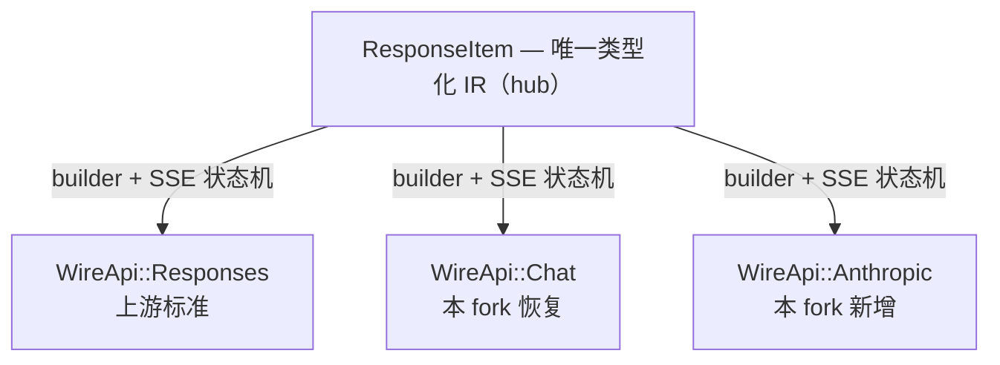

> English version: [README.md](README.md)

<p align="center"><strong>Codex CLI</strong> 是 OpenAI 的编程 Agent，本地运行在你的电脑上。
<p align="center">
  
</p>
</br>
如果你想在代码编辑器（VS Code、Cursor、Windsurf）里使用 Codex，<a href="https://developers.openai.com/codex/ide">在 IDE 中安装</a>。
</br>如果你想要桌面应用体验，运行 <code>codex app</code> 或访问 <a href="https://chatgpt.com/codex?app-landing-page=true">Codex App 页面</a>。
</br>如果你要找的是 OpenAI 的<em>云端 Agent</em>（<strong>Codex Web</strong>），前往 <a href="https://chatgpt.com/codex">chatgpt.com/codex</a>。</p>

---

## 这个 fork 是什么

`tri-wire-api` 是 `openai/codex` 的一个 fork，在单一内部表示上为 CLI 提供三条出站 wire 协议：

- **Responses**（`/v1/responses`）— 上游仅存的 wire。
- **Chat Completions**（`/v1/chat/completions`）— 上游已删除；本 fork 将其恢复为一等协议。
- **Anthropic Messages**（`/v1/messages`）— 本 fork 新增，含 extended-thinking 链（`thinking_delta` / `signature_delta` SSE 帧、`budget_tokens` 钳制、`cache_control` 临时断点、`thinking` 块的带签名重放）。

每个 provider 用一个配置键 `wire_api` 选协议。没有自动协商，没有故障转移：provider 说的就是你给它声明的那条协议。

## 该不该用这个 fork？

| 你的情况                                                                                                                                                                               | 用哪个                                                                                |
| -------------------------------------------------------------------------------------------------------------------------------------------------------------------------------------- | ------------------------------------------------------------------------------------- |
| 你只连 OpenAI Responses（`/v1/responses`）                                                                                                                                             | **上游 `openai/codex`**——本 fork 给不了你更多                                         |
| 你需要在一个二进制后面用 Responses、Chat Completions 或 Anthropic Messages 的任意组合（不实现 `/v1/responses` 的网关：LM Studio、Ollama、DeepSeek 风格 chat 端点、Anthropic 兼容网关） | **本 fork**——一个二进制，一份配置，三种协议                                           |
| 多个非 Codex 客户端挂在一个端点后面                                                                                                                                                    | **LiteLLM Proxy / Portkey**——独立网关才是对的形态；本 fork 是进程内 wire 层，不是代理 |

## 安装

每个发行版发布三个压缩包加一个 `SHA256SUMS`，每个平台一个；最新一版带 GitHub 的 **Latest** 徽标：
**[releases/latest](https://github.com/Xxx91n/codex/releases/latest)**。

| 平台                   | 文件                                                    |
| ---------------------- | ------------------------------------------------------- |
| Windows x86_64         | `codex-<version>-win-x86_64-pc-windows-msvc.zip`        |
| Linux x86_64           | `codex-<version>-linux-x86_64-unknown-linux-gnu.tar.gz` |
| macOS（Apple Silicon） | `codex-<version>-mac-aarch64-apple-darwin.tar.gz`       |

1. 下载你平台的压缩包。
2. 解压——里面只有一个二进制。改名为 `codex`（Windows：`codex.exe`），放进 `PATH`。
3. 验证构建：`codex --version` 输出 `X.Y.Z-tri.N`。结尾不带 `-tri.N` 的，不是本 fork 的构建。
4. 验证完整性：从同一发行页下载 `SHA256SUMS`，运行 `sha256sum -c SHA256SUMS`（Windows：`certutil -hashfile <文件> SHA256`）。构建溯源：`gh attestation verify <文件> --repo Xxx91n/codex`。

**macOS：** 二进制未公证。首次运行先清除隔离属性：`xattr -d com.apple.quarantine ./codex`。

**升级：** 二进制不带自更新——下载新压缩包覆盖旧文件即可。

**版本排序：** `-tri.N` 标记使版本在比较时低于同号上游版本，版本比较器会认为官方构建更新。本仓库的发行页才是 fork 的权威。

### 更换 Codex Desktop 应用的引擎（Windows）

Codex Desktop 应用可以通过 `CODEX_CLI_PATH` 用户环境变量运行另一个 CLI 引擎：

```powershell
setx CODEX_CLI_PATH "D:\path\to\codex.exe"
```

之后完全重启应用（该变量在引擎启动时读取）。回滚就清掉变量（`reg delete "HKCU\Environment" /v CODEX_CLI_PATH /f`，或系统属性 → 环境变量），再重启一次。

**校验和家族（ADR-0011）：** fork 构建内嵌与同平台官方构建相同的 sqlx 迁移校验和家族（Windows = CRLF，Linux/macOS = LF），所以在本 fork 与官方 CLI 之间换 `CODEX_CLI_PATH` 不会墙锁共享的 `~/.codex` 数据库。如果启动报 `checksum family mismatch`，按报错提示跑一次修复命令——例如 `codex state fix-checksums --family crlf --apply`——再冷启动官方 CLI 验证。完整手册在 [docs/fork-checksum-family.md](./docs/fork-checksum-family.md)。

### 从源码构建

见 [docs/install.md](./docs/install.md)。注意仓库自身的规则：重构建与发行验收都在 CI 跑；本地 `codex-rs/target/` 只是一次性缓存。

### 想找官方 Codex CLI？

本仓库只描述**本 fork** 的安装。官方 OpenAI Codex CLI 请前往 [openai/codex](https://github.com/openai/codex)。

## 三条 wire 的配置

每个 provider 一个 `wire_api` 值，声明在 `~/.codex/config.toml`：

```toml
# ~/.codex/config.toml

# 默认：上游行为，一个 provider，一条 wire
model_provider = "openai"

# --- Responses wire（OpenAI 原生 /v1/responses）---
[model_providers.gw-resp]
name        = "gw-resp"
base_url    = "https://example.com/v1"   # 路径停在 /v1；wire 自己追加 /responses、/chat/completions 或 /messages
wire_api    = "responses"
env_key     = "MY_API_KEY"

# --- Chat Completions wire（OpenAI 旧协议，本 fork 恢复）---
[model_providers.gw-chat]
name        = "gw-chat"
base_url    = "https://example.com/v1"
wire_api    = "chat"
env_key     = "MY_API_KEY"

# --- Anthropic Messages wire（/v1/messages）---
[model_providers.gw-msg]
name        = "gw-msg"
base_url    = "https://example.com/v1"
wire_api    = "anthropic"
env_key     = "MY_API_KEY"

# 可选的 anthropic 专属旋钮（按 provider；不设则用内置默认）：
anthropic_max_tokens      = 128000   # 输出预算
anthropic_thinking_budget = 8192     # extended-thinking budget_tokens（钳制在 1024..max_tokens-1）
anthropic_prompt_caching  = true     # 给 system prompt + 最后一个工具打 cache_control: ephemeral
anthropic_adaptive_thinking = false  # Claude 4.6+：发送 thinking:{type:adaptive} + output_config.effort，而非 budget_tokens
```

要按次切换 provider，就为该次调用覆盖 `model_provider`——例如 `codex -c model_provider="gw-msg" -m claude-… "…"`；或者把各 wire 的设置放进 `$CODEX_HOME/<name>.config.toml` profile 文件，用 `codex -p <name>` 选一份。`-m` 选的是模型。

行为说明：

- `experimental_bearer_token` 可以代替 `env_key`，用于在下游注入认证的网关——值用真实 token，或用你的网关约定的写法。
- wire 自己追加路径（`POST /v1/responses`、`POST /v1/chat/completions`、`POST /v1/messages`）；fork 从不剥离或改写 base_url 路径。
- Anthropic wire 上，带 SSE `signature` 的 `thinking` 块逐字重放。无签名块按上游类型分派（ADR-0009）：第一方 `anthropic.com` 端点可以丢，但必须 warn 级日志响亮；第三方兼容端点逐字回传。非 data-URI 图片与截断的工具调用 JSON 都响亮失败，绝不静默伪造。
- `reasoning_effort` 按 wire 翻译：Chat 发顶层 `reasoning_effort` 字段（`minimal`→`low`，`xhigh`/`max`→`high`）；Anthropic 按 `anthropic_adaptive_thinking` 路由——adaptive 发 `output_config.effort`，手动把 effort 分桶进 `budget_tokens`（1024/2048/4096，钳制）。翻译是纯函数、确定性的——见 [docs/adr/0005](docs/adr/0005-reasoning-effort-translation.md)。
- 一个回合永远只在一条 wire 上运行；换 wire 意味着用另一个 provider 选择开新回合。

## 局限

- **不是代理。** `wire_api` 是一个 provider 一个协议——没有自动协商，wire 或 provider 之间也没有故障转移。
- **macOS 二进制未公证**；首次运行需要 `xattr -d com.apple.quarantine ./codex`。
- **没有自更新。** 升级就是下载新压缩包覆盖旧二进制。
- **版本排序。** `-tri.N` 低于同号上游版本，版本比较器会认为官方构建更新。
- **第一方 Anthropic 端点上的无签名 thinking 块**可能被丢弃（warn 级日志），而不是回传；条件规则见 ADR-0009。

## 工作原理

fork 是 hub-and-spoke：一个单一类型化内部表示 `ResponseItem` 居中，每条 wire 是一根辐条——一个请求构造器加一个入站 SSE 状态机。新增协议的代价是 O(N)，而非两两翻译的 O(N²)。与上游的分歧收敛在三个注册点：

1. `codex-rs/model-provider-info/src/lib.rs` 里的 `WireApi` 枚举；
2. 同文件里的 `ModelProviderInfo.wire_api` 字段；
3. `ModelClientSession::stream`（`codex-rs/core/src/client.rs`）里的 dispatch `match`。

上游仍只定义 `WireApi::Responses`，所以本 fork 的 `chat` 与 `anthropic` 变体永远不会与上游漂移相撞。



per-wire 代码是两对模块：出站构造器与流式循环在 `codex-rs/core/src/client/wire/`（`chat.rs`、`anthropic.rs`），入站 SSE 状态机在 `codex-rs/codex-api/src/sse/`（`chat_completions.rs`、`messages.rs`）。Anthropic 状态机沿用 goose 蓝图（Block 的 Rust agent），不是手搓解析器。

### 如何加第四条 wire

新的出站协议沿用同一蓝图。约束性规则是 [wire/AGENTS.md](codex-rs/core/src/client/wire/AGENTS.md) 红线 1–2：新模块文件加三个注册点全部登记，遵循 `chat.rs` 形状（builder + 流式循环在模块内，分发只在 `client.rs`）：

1. **加模块对。** 出站请求构造器 + 流式循环放 `codex-rs/core/src/client/wire/<new>.rs`；入站 SSE 状态机放 `codex-rs/codex-api/src/sse/<new>.rs`。
2. **三个注册点一起更新。** `WireApi` 变体及其 `wire_api` 配置面在 `codex-rs/model-provider-info/src/lib.rs`；分发分支在 `ModelClientSession::stream`。
3. **加 wiremock 夹具。** 新辐条的重放夹具 + 往返测试进 seam 套件，让 `fork-health.yml` 从第一天就守护它。
4. **加词汇。** 新术语先入 [CONTEXT.md](CONTEXT.md)——fork 的词汇权威——带用法/禁用配对，然后代码才能合。
5. **记录决策。** [docs/adr/](docs/adr/) 下立 ADR，并按 [ADR-0006](docs/adr/0006-fork-divergence-patch-queue.md) 在 FORK_DIVERGENCE 补丁队列里登记。

## 这个 fork 为什么存在

Codex 模型家族从一开始就只承诺 Responses，OpenAI 又分波次退掉了例外：`codex-mini-latest` 于 2026-02-12 离场，其余 Codex API 模型（`gpt-5-codex` 到 `gpt-5.2-codex`）于 2026-07-23 关停，2026-08-04 连 `gpt-5.3-codex`——最后一个还在 `/v1/chat/completions` 上过渡接受的模型——也被撤下。LiteLLM Proxy 的桥接路由留了一条仍在把该模型映射到已删端点的通配路由，约 4 小时内每个经过它的请求都吃 404——热修之前 1700+ 次失败请求（LiteLLM issue #35879；OpenAI Deprecations 页面的 02-12 与 07-23 两波）。故障活在一个*第三方运营的服务端协议桥*里，而客户端被动依赖它。

本 fork 避开这类故障的方式是拒绝把协议翻译托付给别人的路由器：三条 wire 原生编进客户端本体，由 `wire_api` 选择。没有可断的桥，没有会跑偏的通配——翻译就活在你要运行的二进制里，由 fork 缝 CI 端到端守护。

## 开发与 CI

本地开发只需要 Rust 工具链（`codex-rs/rust-toolchain.toml` 钉在 `1.99.1`）和 `just`，用于 `fmt`/`clippy`/`test`。重活都跑在 GitHub Actions：

- `fork-health.yml`——每日上游漂移看门狗：fmt、seam crate 的 clippy、wiremock 套件、merge-base 漂移探测。
- `fork-cli-test-release.yml`——`workflow_dispatch` 手动触发：`check` 作业加三平台发行构建。
- `fork-publish.yml`——把一次已完成构建的压缩包发布为发行版，附 `SHA256SUMS` 与构建溯源（ADR-0018）。

## Fork 文档地图

每层都是自己内容的唯一权威——需要哪层读哪层，按这个顺序：

1. **[CONTEXT.md](CONTEXT.md)** — tri-wire 词汇权威：术语、用法/禁用配对、出处。命名任何新东西之前先读它。
2. **[docs/adr/](docs/adr/)** — append-only 决策记录（[索引](docs/adr/README.md)）；0001 是 fork 基线与 merge-don't-rebase 同步。
3. **[AGENTS.md](AGENTS.md)** — 面向 agent 的规则；fork 宪章一节是红线。嵌套链（就近文件优先）：[codex-rs/AGENTS.md](codex-rs/AGENTS.md) → [core/src/client/wire/AGENTS.md](codex-rs/core/src/client/wire/AGENTS.md) 是 per-wire 协议规则。
4. **上游跟踪：** 本 fork merge `upstream/main`，绝不 rebase（ADR-0001）。

## 文档

- [**Codex 官方文档**](https://developers.openai.com/codex)
- [**贡献指南**](./docs/contributing.md)
- [**安装与构建**](./docs/install.md)
- [**开源基金**](./docs/open-source-fund.md)

本仓库基于 [Apache-2.0 许可证](LICENSE) 授权。
