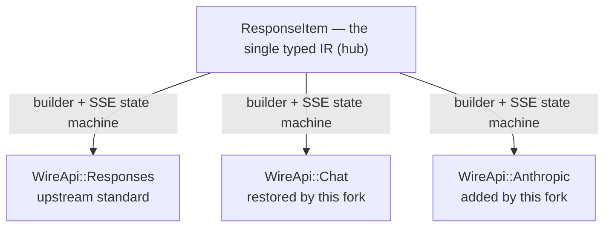

> 中文版本：[README-ZH.md](README-ZH.md)

<p align="center"><strong>Codex CLI</strong> is a coding agent from OpenAI that runs locally on your computer.
<p align="center">
  
</p>
</br>
If you want Codex in your code editor (VS Code, Cursor, Windsurf), <a href="https://developers.openai.com/codex/ide">install in your IDE.</a>
</br>If you want the desktop app experience, run <code>codex app</code> or visit <a href="https://chatgpt.com/codex?app-landing-page=true">the Codex App page</a>.
</br>If you are looking for the <em>cloud-based agent</em> from OpenAI, <strong>Codex Web</strong>, go to <a href="https://chatgpt.com/codex">chatgpt.com/codex</a>.</p>

---

## What this fork is

`tri-wire-api` is a fork of `openai/codex` that gives the CLI three outbound
wire protocols on one internal representation:

- **Responses** (`/v1/responses`) — upstream's only remaining wire.
- **Chat Completions** (`/v1/chat/completions`) — removed by upstream; restored
  here as a first-class protocol.
- **Anthropic Messages** (`/v1/messages`) — added by this fork, including the
  extended-thinking chain (`thinking_delta` / `signature_delta` SSE frames,
  `budget_tokens` clamping, `cache_control` ephemeral breakpoints, and
  signature-preserving replay of `thinking` blocks).

Pick the wire per provider with one config key, `wire_api`. There is no
auto-negotiation and no failover: a provider speaks exactly the protocol you
declare for it.

## Should you use this fork?

| Your situation | Use |
|---|---|
| You only talk to OpenAI Responses (`/v1/responses`) | **upstream `openai/codex`** — this fork adds nothing you need |
| You need Responses, Chat Completions, or Anthropic Messages behind one binary (gateways without `/v1/responses`: LM Studio, Ollama, DeepSeek-style chat endpoints, Anthropic-compatible gateways) | **this fork** — one binary, one config, three protocols |
| Many non-Codex clients behind one endpoint | **LiteLLM Proxy / Portkey** — a standalone gateway is the right shape; this fork is an in-process wire layer, not a proxy |

## Install

Every release publishes three archives plus a `SHA256SUMS`, one archive per
platform. The newest release carries GitHub's **Latest** badge:
**[releases/latest](https://github.com/Xxx91n/codex/releases/latest)**.

| Platform | File |
|---|---|
| Windows x86_64 | `codex-<version>-win-x86_64-pc-windows-msvc.zip` |
| Linux x86_64 | `codex-<version>-linux-x86_64-unknown-linux-gnu.tar.gz` |
| macOS (Apple Silicon) | `codex-<version>-mac-aarch64-apple-darwin.tar.gz` |

1. Download the archive for your platform.
2. Extract it — it contains a single binary. Rename it to `codex` (Windows:
   `codex.exe`) and put it on your `PATH`.
3. Verify the build: `codex --version` prints `X.Y.Z-tri.N`. Anything not
   ending in `-tri.N` is not this fork.
4. Verify integrity: download `SHA256SUMS` from the same release page and run
   `sha256sum -c SHA256SUMS` (Windows: `certutil -hashfile <file> SHA256`).
   Build provenance: `gh attestation verify <file> --repo Xxx91n/codex`.

**macOS:** the binary is not notarized. On first run, clear the quarantine flag:
`xattr -d com.apple.quarantine ./codex`.

**Upgrading:** the binary has no self-updater — download the new archive and
replace the binary.

**Version ordering:** the `-tri.N` marker sorts below the same upstream version
number, so a comparator will report the official build as newer. This
repository's release page is the authority for the fork.

### Swapping the Codex Desktop app's engine (Windows)

The Codex Desktop app can run a different CLI engine through the
`CODEX_CLI_PATH` user environment variable:

```powershell
setx CODEX_CLI_PATH "D:\path\to\codex.exe"
```

Fully restart the app afterwards (the variable is read at engine spawn). To roll
back, clear the variable (`reg delete "HKCU\Environment" /v CODEX_CLI_PATH /f`
or System Properties → Environment Variables) and restart again.

**Checksum family (ADR-0011):** fork builds embed the same sqlx migration
checksum family as an official build of the same platform (Windows = CRLF,
Linux/macOS = LF), so swapping `CODEX_CLI_PATH` between this fork and the
official CLI does not wall-lock the shared `~/.codex` databases. If a startup
reports `checksum family mismatch`, run the repair command the error names
once — e.g. `codex state fix-checksums --family crlf --apply` — then cold-start
the official CLI to verify. The runbook is
[docs/fork-checksum-family.md](./docs/fork-checksum-family.md).

### Building from source

See [docs/install.md](./docs/install.md). Note the repo's own rule: heavy
builds and release acceptance run in CI; a local `codex-rs/target/` is a
disposable cache.

### Looking for the official Codex CLI?

This repository only documents installing **this fork**. For the official
OpenAI Codex CLI, go to [openai/codex](https://github.com/openai/codex).

## Configuring the three wires

One `wire_api` value per provider, declared in `~/.codex/config.toml`:

```toml
# ~/.codex/config.toml

# default: upstream behaviour, one provider, one wire
model_provider = "openai"

# --- Responses wire (OpenAI native /v1/responses) ---
[model_providers.gw-resp]
name        = "gw-resp"
base_url    = "https://example.com/v1"   # path stays at /v1; the wire appends /responses, /chat/completions, or /messages itself
wire_api    = "responses"
env_key     = "MY_API_KEY"

# --- Chat Completions wire (OpenAI legacy, restored by this fork) ---
[model_providers.gw-chat]
name        = "gw-chat"
base_url    = "https://example.com/v1"
wire_api    = "chat"
env_key     = "MY_API_KEY"

# --- Anthropic Messages wire (/v1/messages) ---
[model_providers.gw-msg]
name        = "gw-msg"
base_url    = "https://example.com/v1"
wire_api    = "anthropic"
env_key     = "MY_API_KEY"

# optional anthropic-only knobs (per-provider; leave unset for built-in defaults):
anthropic_max_tokens      = 128000   # output budget
anthropic_thinking_budget = 8192     # extended-thinking budget_tokens (clamped to 1024..max_tokens-1)
anthropic_prompt_caching  = true     # marks system prompt + last tool with cache_control: ephemeral
anthropic_adaptive_thinking = false  # Claude 4.6+: sends thinking:{type:adaptive} + output_config.effort instead of budget_tokens
```

To switch provider per run, override `model_provider` for that invocation — for
example `codex -c model_provider="gw-msg" -m claude-… "…"`, or keep per-wire
settings in `$CODEX_HOME/<name>.config.toml` profile files and select one with
`codex -p <name>`. The `-m` flag selects the model.

Behaviour notes:

- `experimental_bearer_token` can replace `env_key` when a gateway injects auth
  downstream — point it at a real token or at the convention your gateway
  expects.
- The wire appends its own path (`POST /v1/responses`,
  `POST /v1/chat/completions`, `POST /v1/messages`); the fork never strips or
  rewrites base-URL paths.
- On the Anthropic wire, `thinking` blocks with an SSE `signature` replay
  verbatim. Unsigned blocks dispatch by upstream type (ADR-0009): first-party
  `anthropic.com` endpoints may drop them with a warn-level log; compatible
  third-party endpoints replay them verbatim. Non-data-URI images and truncated
  tool-call JSON fail loudly rather than being silently fabricated.
- `reasoning_effort` translates per wire: Chat sends a top-level
  `reasoning_effort` field (`minimal`→`low`, `xhigh`/`max`→`high`); Anthropic
  routes by `anthropic_adaptive_thinking` — adaptive sends
  `output_config.effort`, manual buckets the effort into `budget_tokens`
  (1024/2048/4096, clamped). Translation is pure and deterministic — see
  [docs/adr/0005](docs/adr/0005-reasoning-effort-translation.md).
- A turn always runs on exactly one wire; switching wires means starting a new
  turn with a different provider selection.

## Limitations

- **Not a proxy.** `wire_api` is one protocol per provider — there is no
  auto-negotiation and no failover between wires or providers.
- **macOS binary is not notarized**; first run needs
  `xattr -d com.apple.quarantine ./codex`.
- **No self-updater.** Upgrading means downloading the new archive and
  replacing the binary.
- **Version ordering.** `-tri.N` sorts below the same upstream version, so
  version comparators will report the official build as newer.
- **Unsigned thinking blocks on first-party Anthropic endpoints** may be
  dropped (with a warn-level log) rather than replayed; the conditional rule is
  ADR-0009.

## How it works

The fork is hub-and-spoke: a single typed internal representation,
`ResponseItem`, sits in the middle, and every wire is one spoke — a request
builder plus an inbound SSE state machine. Adding a protocol costs O(N), not
the O(N²) of pairwise translation. The divergence from upstream is contained to
three registration points:

1. the `WireApi` enum in `codex-rs/model-provider-info/src/lib.rs`,
2. the `ModelProviderInfo.wire_api` field in the same file,
3. the dispatch `match` in `ModelClientSession::stream`
   (`codex-rs/core/src/client.rs`).

Upstream still only defines `WireApi::Responses`, so the fork's `chat` and
`anthropic` variants never collide with upstream drift.



Per-wire code lives in two module pairs: outbound builders and streaming loops
in `codex-rs/core/src/client/wire/` (`chat.rs`, `anthropic.rs`), inbound SSE
state machines in `codex-rs/codex-api/src/sse/` (`chat_completions.rs`,
`messages.rs`). The Anthropic state machine follows the goose blueprint
(Block's Rust agent), not a hand-rolled parser.

### Adding a fourth wire

A new outbound protocol follows the same blueprint. The binding rules are red
lines 1–2 of [wire/AGENTS.md](codex-rs/core/src/client/wire/AGENTS.md): a new
module file plus registration at all three points, following the `chat.rs`
shape (builder + streaming loop in the module, dispatch only in `client.rs`):

1. **Add the module pair.** Outbound request builder + streaming loop in
   `codex-rs/core/src/client/wire/<new>.rs`; inbound SSE state machine in
   `codex-rs/codex-api/src/sse/<new>.rs`.
2. **Update the three registration points together.** `WireApi` variant and
   `wire_api` config surface in `codex-rs/model-provider-info/src/lib.rs`;
   dispatch branch in `ModelClientSession::stream`.
3. **Add wiremock fixtures.** Replay fixtures + round-trip tests for the new
   spoke in the seam suites, so `fork-health.yml` guards it from day one.
4. **Add the vocabulary.** New terms go into [CONTEXT.md](CONTEXT.md) — the
   fork's vocabulary authority — with usage and prohibited-usage pairs, before
   the code merges.
5. **Record the decision.** An ADR under [docs/adr/](docs/adr/), plus an entry
   in the FORK_DIVERGENCE patch queue per
   [ADR-0006](docs/adr/0006-fork-divergence-patch-queue.md).

## Why this fork exists

The Codex model family was documented as Responses-only from the start, and
OpenAI retired the exceptions in waves: `codex-mini-latest` left the API on
2026-02-12, the remaining Codex API models (`gpt-5-codex` through
`gpt-5.2-codex`) were shut down on 2026-07-23, and on 2026-08-04
`gpt-5.3-codex` — the last model still transitionally accepted on
`/v1/chat/completions` — was pulled too. LiteLLM Proxy's bridge router kept a
wildcard route mapping that model to the removed endpoint; for roughly 4 hours
every request through it returned 404 — 1,700+ failed requests before the
hotfix (LiteLLM issue #35879; OpenAI Deprecations page for the 02-12 and 07-23
waves). The outage lived inside a *server-side protocol bridge* that clients
passively depended on.

This fork avoids that failure class by refusing to delegate protocol
translation to somebody else's router: all three wires are built natively into
the client, selected by `wire_api`. There is no bridge to break and no wildcard
to misroute — the translation lives in the binary you run, guarded end-to-end
by the fork-seam CI.

## Development and CI

Local development only needs the Rust toolchain (pinned to `1.99.1` by
`codex-rs/rust-toolchain.toml`) and `just` for `fmt`/`clippy`/`test`. Heavy
work runs in GitHub Actions:

- `fork-health.yml` — daily upstream-drift watchdog: fmt, clippy over the seam
  crates, wiremock suites, and a merge-base drift probe.
- `fork-cli-test-release.yml` — manual `workflow_dispatch` run: `check` job
  plus three-platform release builds.
- `fork-publish.yml` — publishes the archives of a completed build run as a
  release with `SHA256SUMS` and build attestation (ADR-0018).

## Fork documentation map

Each layer is the single source for its content — read what you need, in this
order:

1. **[CONTEXT.md](CONTEXT.md)** — tri-wire vocabulary authority: terms,
   usage/prohibited-usage pairs, sources. Read it before naming anything new.
2. **[docs/adr/](docs/adr/)** — append-only decision records
   ([index](docs/adr/README.md)); 0001 covers the fork baseline and
   merge-don't-rebase sync.
3. **[AGENTS.md](AGENTS.md)** — agent-facing rules; the fork constitution holds
   the red lines. Nested chain (nearest file wins):
   [codex-rs/AGENTS.md](codex-rs/AGENTS.md) →
   [core/src/client/wire/AGENTS.md](codex-rs/core/src/client/wire/AGENTS.md)
   for per-wire protocol rules.
4. **Upstream tracking:** the fork merges `upstream/main`; it never rebases
   (ADR-0001).

## Docs

- [**Codex Documentation**](https://developers.openai.com/codex)
- [**Contributing**](./docs/contributing.md)
- [**Installing & building**](./docs/install.md)
- [**Open source fund**](./docs/open-source-fund.md)

This repository is licensed under the [Apache-2.0 License](LICENSE).
